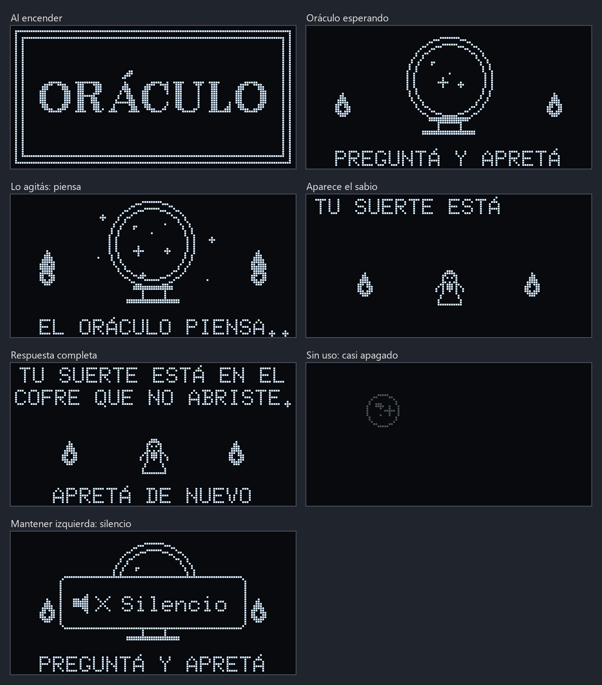
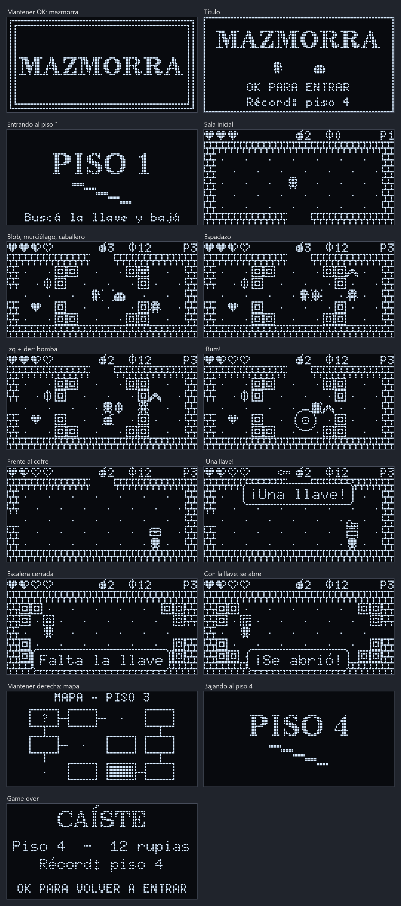

# Oráculo y Mazmorra

Un aparatito de escritorio con estética de aventura clásica. Usa una **XIAO ESP32-S3**, una **OLED de 128x64**, un **buzzer pasivo**, **3 botones** y un acelerómetro **MPU-6050**. También muestra las **notificaciones del teléfono** por Bluetooth.

- **Oráculo:** es lo que muestra siempre. Una esfera brilla entre dos fuegos. Le hacés una pregunta en voz alta y lo agitás: la esfera tiembla, aparece el sabio y te da un consejo letra por letra. Hay respuestas tipo bola 8, profecías y consejos absurdos.
- **Cartas:** cuando te llega una notificación al teléfono, un hada mensajera cruza la pantalla con una carta y se abre un pergamino con quién te escribe y el mensaje. Funciona encima del oráculo y del juego.
- **Mazmorra:** mantené apretado **OK** para entrar, y otra vez para volver al oráculo. Es un juego por turnos visto desde arriba: buscá el cofre con la llave, abrí la escalera y bajá al piso siguiente. Cada piso es distinto y cada vez más difícil.

## Cómo se ve

Capturas generadas con el mismo código corriendo en la PC:





## Controles

**Siempre**

| Acción | Botón |
|---|---|
| Cambiar entre oráculo y mazmorra | mantener **OK** |
| Silenciar o activar el sonido | mantener **izquierda** |

**Oráculo:** agitalo. Sin sensor, cualquier botón le hace la pregunta. Después de 2 minutos sin uso, la pantalla se apaga casi del todo. Mantené **derecha** para releer las notificaciones; el sobrecito de arriba a la derecha cuenta las que no leíste.

**Cartas (notificaciones)**

| Acción | Botón |
|---|---|
| Avanzar el texto / cerrar la carta | **OK** |
| Notificación más vieja / más nueva | **izquierda** / **derecha** |
| Silenciar una llamada entrante | cualquiera |

Guarda las últimas 10. Los emojis no se muestran porque la fuente de la pantalla no los tiene.

**Mazmorra**

| Acción | Botón |
|---|---|
| Girar | **izquierda** / **derecha** |
| Avanzar, atacar o abrir lo que tenés enfrente | **OK** |
| Poner una bomba | **izquierda + derecha** juntos |
| Ver el mapa del piso | mantener **derecha** |

- Los enemigos se mueven solo cuando vos avanzás. Girar no gasta turno.
- Las esquinitas que titilan marcan el casillero al que vas a avanzar.
- **Blob:** lento. **Murciélago:** se mueve medio al azar. **Caballero:** te persigue, aguanta 2 golpes y saca un corazón entero.
- Las bombas explotan a los 3 turnos, rompen bloques y lastiman a todo lo que esté alrededor, incluido vos.
- En algunos pisos, el cofre del premio trae un corazón extra.
- El récord (piso más profundo y rupias) se guarda aunque lo desenchufes.

## Conexiones

| Componente | Pin del módulo | XIAO ESP32-S3 |
|---|---|---|
| OLED | GND / VCC | GND / 3V3 |
| OLED | SCL / SDA | **D5 / D4** |
| Buzzer | S / medio / − | **D3** / 3V3 / GND |
| Botón izquierdo | entre pin y GND | **D0** |
| Botón del medio (OK) | entre pin y GND | **D8** |
| Botón derecho | entre pin y GND | **D2** |
| MPU-6050 | VCC / GND | 3V3 (o 5V) / GND |
| MPU-6050 | SCL / SDA | **D5 / D4** (las mismas que la pantalla) |

## Notificaciones del teléfono (Android)

1. Instalá la app **Chronos** y dale **acceso a notificaciones** en los ajustes de Android.
2. En Chronos, buscá y conectá el reloj **"Oraculo"**.
3. En la lista de notificaciones de Chronos, activá las apps que quieras ver.

Chronos no siempre le dice a la placa de qué app es cada notificación: si no la reconoce, la carta dice solo "CARTA".

## Personalizar

En [`include/config.h`](include/config.h):

- **`SHAKE_G` / `SHAKE_PEAKS` / `SHAKE_WINDOW_MS`:** qué tan fuerte hay que agitarlo. Si no encuentra el MPU-6050, lo vuelve a buscar cada 2 segundos.
- **`SHAKE_DEBUG`:** en 1 muestra arriba lo que mide el sensor, para ajustarlo.
- **`SLEEP_AFTER_MS`:** cuánto espera antes de apagar la pantalla.
- **`OLED_TYPE`:** 1 = SSD1309, 2 = SSD1306, 3 = SH1106.

Las frases del oráculo están al principio de [`src/oracle.cpp`](src/oracle.cpp). Podés agregar las tuyas.

## Compilar y subir

```bash
pio run -e xiao_esp32s3 -t upload
```

Si no aparece el puerto, mantené apretado el botón **B** (BOOT) de la XIAO mientras la conectás.

---
Proyecto de fan, con personajes, dibujos y música propios.
